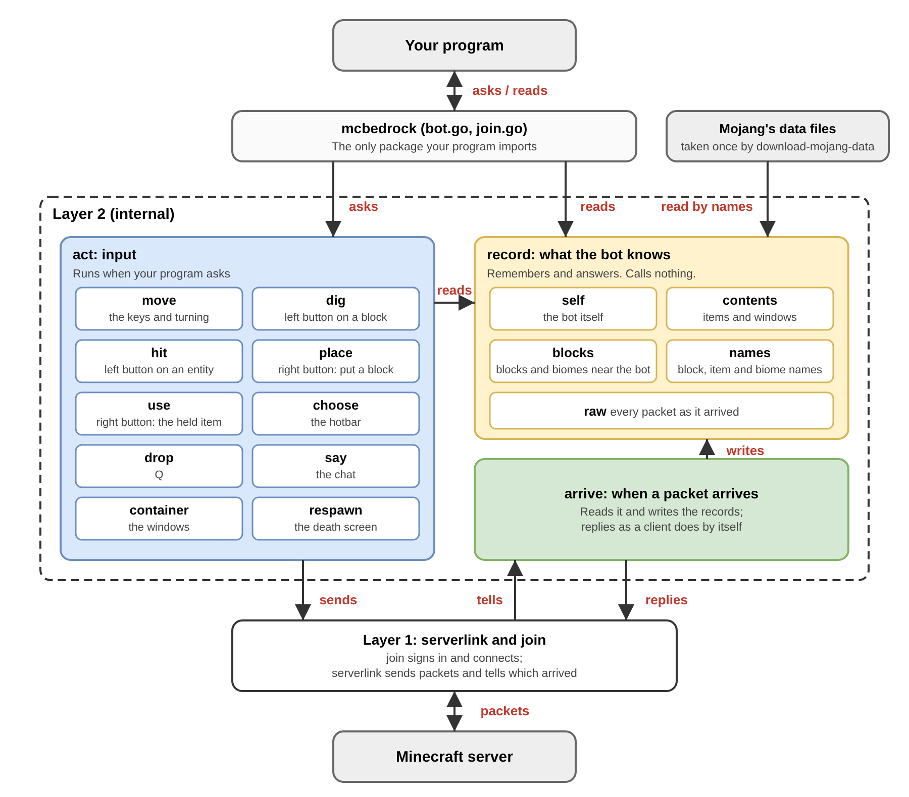

# mcbedrock-bot

mcbedrock-bot is a Go library for **Minecraft Bedrock Edition bots**: it gives
a program the **basic actions** of a player, so that the program can play in
place of a human. Each call is what a player does with the keys, the mouse
buttons, the hotbar or a window: walk, jump, dig, place a block, use an item,
chat, open a chest, respawn. What the server tells can be read back, or heard
as it arrives: where the bot is, its health and items, the blocks and biomes
around it, the mobs, players and items near it.

mcbedrock-bot does not decide anything. It has no path finding, no fighting
and no plans: those belong to the program built on top of it.

> NOT AN OFFICIAL MINECRAFT PRODUCT. NOT APPROVED BY OR ASSOCIATED WITH MOJANG OR MICROSOFT.

## Rules

- Join only worlds you own, or worlds whose owner has said yes.
- mcbedrock-bot sends what a player's client sends, and nothing on its own: no cheats.
- Follow the [Minecraft EULA](https://www.minecraft.net/eula) and the rules of the world you join.

## Requirements

- Go 1.25 or later
- A Microsoft account that owns Minecraft Bedrock Edition
- A world opened to LAN ("Visible to LAN Players") on the same network

mcbedrock-bot is tested on Windows with Minecraft 1.26.60.

## Install

```
go get github.com/otya0/mcbedrock-bot
```

Then take Mojang's data once (see below):

```
go run github.com/otya0/mcbedrock-bot/cmd/download-mojang-data@latest
```

## Try it

Open a world with "Visible to LAN Players" on, then run the smallest whole
program, [examples/hello](examples/hello/main.go). It joins, says where the
bot is and what is around it, and leaves after ten seconds; its log shows
each step of joining, so a failure says where it stopped.

```
go run github.com/otya0/mcbedrock-bot/examples/hello@latest
```

## Example

The package name is `mcbedrock`. For a whole program, see
[examples/hello](examples/hello/main.go).

```go
import "github.com/otya0/mcbedrock-bot"

bot, err := mcbedrock.Join(ctx, mcbedrock.Options{})
if err != nil {
	log.Fatal(err)
}
defer bot.Close()

// Act: hold a key, then let it go.
bot.Move().StartForward()
time.Sleep(2 * time.Second)
bot.Move().StopForward()

// Read: what the server has told.
block, ok := bot.Blocks().At(protocol.BlockPos{10, 64, -3})
if ok {
	fmt.Println(block.Name, block.Biome) // minecraft:stone minecraft:plains
}
for _, e := range bot.Entities().All() {
	fmt.Println(e.Type, e.Name, e.Position) // minecraft:sheep  [-76.1 63 -114.9]
}

// Hear: every tick, and every packet as it arrives.
bot.OnTick(func(tick uint64) {
	if health, _ := bot.Self().Health(); health < 6 {
		bot.Move().StartBack()
	}
})
bot.OnPacket(func(p packet.Packet) {
	if text, ok := p.(*packet.Text); ok {
		fmt.Println("chat:", text.Message)
	}
})
```

## What the bot can do, read and hear

- **Doors** (what the bot does): `Move` (the keys and turning), `Dig` (the left
  button on a block), `Hit` (the left button on an entity), `Place` and `Use`
  (the right button), `Choose` (the hotbar), `Drop` (Q), `Say` (the chat),
  `Container` (the windows: chests, crafting, trading, enchanting, anvils and
  more), `Respawn` (the death screen). The server decides what happens.
- **Records** (what the server has told): `Self` (position, health, food,
  effects, and how many ticks the block being broken takes), `Contents` (items
  and windows), `Blocks` (the blocks and biomes near the bot, by name),
  `Entities` (the mobs, players and items on the ground around the bot),
  `Names` (the name of any block, item or biome number), `Raw` (the last
  packets of each kind).
- **Hearing**: `OnPacket` is told every packet after the records have it
  (`Options.OnPacket` from the first packet, while joining). `OnTick` is called
  every tick, 20 a second, just before the bot sends its input. Both run
  inside the bot, so return quickly; they run in two goroutines at the same
  time, so guard data that both touch.
- Every type the bot gives has a name in this package: `mcbedrock.Move`,
  `mcbedrock.Block`, `mcbedrock.Entity` and the rest.

## Known limits

- **The position while moving.** The server says where the bot is only when
  it is off by about a block, so `Self().Position()` can be that far behind
  while the bot moves. Once the bot stops, it is where the bot is.
- **No collision shapes.** Whether the bot can stand somewhere is not known yet.
- **LAN worlds only.** Joining a server by its address is not supported yet.

## Plans

- A closer position while the bot moves
- The collision shapes of blocks
- Tests for every door

## Mojang's data

The server sends blocks and biomes as numbers. To give them names,
mcbedrock-bot reads Mojang's own lists from
[Mojang/bedrock-samples](https://github.com/Mojang/bedrock-samples).
These files belong to Mojang, so mcbedrock-bot does not include them:
`download-mojang-data` takes them from Mojang's repository to your computer
(the user cache folder, `mcbedrock-bot/mojang`). `Join` stops with an error
until they are there.

## Account

On a LAN world the bot usually needs no Microsoft account: when the world
accepts self-signed sign-in (Minecraft 1.26.60 did), the bot joins without
one, so you can try it alone, playing with your own account.

If the world asks for an Xbox Live sign-in, the first `Join` prints a login
URL and a code; sign in with an account other than the one you play with.
The token is saved in `mcbedrock_token.json`. **This file is the key to that
account: never share it or commit it.**

## Logs

mcbedrock-bot prints nothing. Give `Options.Logger` a `*slog.Logger` to see
each step of joining and each call it makes.

## How it is built



- **mcbedrock** (`bot.go`, `join.go`) is the only package your program imports.
- **act** sends what a player does, one door per kind of input.
- **record** remembers what the server has told (`Self`, `Contents`,
  `Blocks`, `Entities`, `Names`, `Raw`) and answers when asked.
- **arrive** reads each packet that arrives, writes the records, replies
  where a client replies by itself, then tells your program (`OnPacket`).
- **serverlink** and **join** sign in, connect, send packets and tell which
  ones arrived. They are built on
  [gophertunnel](https://github.com/Sandertv/gophertunnel).

## Questions and bugs

Please open an issue on GitHub.

## License

MIT, see [LICENSE](LICENSE). Mojang's data is not covered: it belongs to Mojang.
